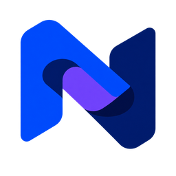

<div align="center">



# Numera Browser

### Local-first browser profiles, persistent sessions and automation

Manage separate browser profiles, proxy settings and sessions from a desktop window,
web dashboard or CLI. Choose Playwright, Patchright, Camoufox or CloakBrowser for
workflows you are authorized to run.

[](https://github.com/KiaroSama/Numera-Browser/actions/workflows/ci.yml)
[](LICENSE)
[](CHANGELOG.md)
[](engine/pyproject.toml)
[](dashboard/package.json)
[](desktop/src-tauri/Cargo.toml)

[](.github/workflows/build-desktop.yml)
[](docs/setup.md)
[](dashboard/package.json)
[](desktop/src-tauri/Cargo.toml)
[](engine/pyproject.toml)
[](dashboard/tsconfig.json)
[](Dockerfile)
[](#donate)

[Download releases](https://github.com/KiaroSama/Numera-Browser/releases) ·
[Installation and setup](docs/setup.md) · [Updates](docs/updates.md) ·
[CLI and MCP](docs/agents.md)


</div>

## What it does

- **Profiles and sessions:** persistent browser storage, editable profile settings,
  folders, tags, search, bulk creation/editing, configuration import/export and
  individual profile/session backups.
- **Browser backends:** select a backend per profile, manage extensions, launch a
  browser or attach automation to an owned session.
- **Proxy management:** import and assign proxies, inspect health, request provider
  rotation and run diagnostic IP/WebRTC/DNS/TLS checks.
- **Dashboard and automation:** profile editor, health overview, scheduled tasks,
  CLI JSON output, HTTP API and MCP. Optional vault protection encrypts stored
  proxy credentials; it does not encrypt every browser file.
- **Portable updates:** review a signed release generation, approve downloading,
  then separately approve installation/restart. SDKs and their managed browser
  binaries update as a compatible unit; see [limits and recovery](docs/updates.md).

The consistency meter checks profile settings against the project's rules. It is
**not** proof of anonymity, undetectability, account isolation at a remote service,
or permission to bypass that service's controls. Browser engines apply different
settings; Camoufox generates parts of its own Firefox identity.

## Install

### Portable desktop

Download a completed matching archive from
[GitHub Releases](https://github.com/KiaroSama/Numera-Browser/releases), verify its
published signature/checksums, and extract the **entire** `Numera Browser` folder.
Run `numera.exe` on Windows or `numera` on Linux/macOS. Keep its engine and browser
resources beside it.

| Build target | Host prerequisites |
|---|---|
| Windows x64 | Compatible Windows and WebView2 runtime. |
| Linux x64 | Compatible glibc distribution, GTK 3/WebKitGTK 4.1 and the browser's system libraries. |
| macOS ARM64 | Apple Silicon and compatible macOS/WKWebView. Not an Intel Mac build. |

A complete portable bundle needs no separate Python or Node installation. OS
warnings can still apply: native signing is **self-signed/private-trust**, not a
publicly trusted publisher certificate or Apple notarization. Do not disable OS
security or install an unknown root certificate to bypass a warning.

Only assets actually present in a completed release are available downloads. The
release pipeline is under verification; a workflow definition or build-target
badge is not evidence that the latest tree has passed or an asset has shipped.

### Source installation

Use Python **3.10+** and a Node version supported by the manifest
(`^22.22.2 || ^24.15.0 || >=26.0.0`). From a checkout, create/activate a virtual
environment as shown in [setup](docs/setup.md#from-source), then:

```bash
python -m pip install -e "./engine[api,launch]"
```

```bash
python -m playwright install chromium
```

```bash
npm --prefix dashboard ci
```

```bash
npm --prefix dashboard run build
```

```bash
python -m numera serve --port 8787
```

Open <http://127.0.0.1:8787>. For frontend development, keep the engine running and
use `npm --prefix dashboard run dev` in a second terminal; Vite proxies `/api` to
port 8787. Without the API the dashboard shows clearly labelled **demo data**.

Detailed platform prerequisites, alternative browser setup, Docker, headless
configuration and troubleshooting are in [docs/setup.md](docs/setup.md).

## Use

Create a profile:

```bash
python -m numera create qa-profile --os windows --locale en-US --engine playwright
```

List saved profiles:

```bash
python -m numera list --json
```

Launch the selected profile:

```bash
python -m numera launch qa-profile
```

Inspect installed browser backends:

```bash
python -m numera engines
```

Set the default deliberately:

```bash
python -m numera default-engine playwright
```

`playwright` is the initial default. Explicit engine choices on creation or
engine-changing edits can update it; editing unrelated fields does not. The
server is authoritative, and Settings shows its saved default.

For command help, use `python -m numera --help`. See
[engine/README.md](engine/README.md) for commands and the Python API,
[docs/agents.md](docs/agents.md) for JSON/MCP workflows, and
[dashboard/README.md](dashboard/README.md) for frontend development.

## Browser engines

| Backend | Browser and distribution boundary |
|---|---|
| `playwright` | Playwright's matched Chromium. Available through the `launch` extra. |
| `patchright` | A separate Patchright SDK and matched Chromium; not Playwright's shared binary. |
| `camoufox` | Camoufox's Firefox build, addons and associated data. Its own generated identity differs from Chromium settings. |
| `cloak` | CloakBrowser wrapper plus a separately licensed vendor browser. The proprietary binary is excluded from public bundles. |

Portable builds bundle Playwright, Patchright and Camoufox resources with their
matching SDK versions. Cloak acquisition requires explicit consent and permitted
vendor access. A vendor tier that cannot supply the requested exact generation
cannot be presented as a tested managed pin. External browser-path overrides
remain user-managed. Third-party licenses, notices and source obligations are
listed in [docs/licensing.md](docs/licensing.md) and
[docs/browser-notices.txt](docs/browser-notices.txt).

## Data, access and updates

**Back up your data, not just the executable.** Settings → Storage shows the actual
data root. Portable data normally lives beside the app when writable; explicit
`--data-dir`/`NUMERA_DATA_DIR` selection takes precedence. Profiles, sessions, proxy
configuration and token records are sensitive. A profile configuration export is
not a full browser-session backup.

Keep the API and CDP endpoints private. `numera serve` binds to localhost by
default; use bearer authentication and a controlled tunnel/reverse proxy for
remote access. A non-loopback bind requires authentication. `NUMERA_ALLOWED_ORIGINS`
restricts browser callers; CORS is not a substitute for authentication.

The portable updater checks the configured project release feed, verifies signed
metadata and asks before downloading or restarting. Active or uncertain work
**defers** activation instead of being force-killed. Source checkouts and containers
use their package/deployment workflow. See [docs/updates.md](docs/updates.md) for
signature verification, recovery, filesystem and trust limits.

## Logs

The retained engine writes UTF-8 logs under the actual data root's `logs/`, one
`numera_YYYY-MM-DD_HH-mm-ss_UTC.log` per run, with a collision suffix when needed.
Entries use `[YYYY-MM-DD HH:mm:ss UTC] [LEVEL] [COMPONENT] Message`. Verbose mode adds
diagnostics; redaction is applied before file output. The engine retains a bounded
set of run logs; see [engine/README.md](engine/README.md) for its exact controls.

Desktop/update and build tooling keep their own lifecycle diagnostics. Logging
initialization failures produce a safe console fallback rather than pretending a
log exists. Review logs before sharing them: redaction is a safety measure, not
permission to publish raw cookies, tokens or profile data.

## Development and verification

| Directory | Responsibility |
|---|---|
| `engine/` | Retained Python application: storage, CLI, HTTP API, MCP and browser orchestration. |
| `engine-rust/` | Non-default native application candidate and parity/ownership acceptance work. |
| `dashboard/` | React + strict TypeScript dashboard. |
| `desktop/` | Tauri window, owned engine lifecycle and portable updater. |
| `scripts/` | Bounded verification, provenance, browser bundling, signing and distribution tools. |

[CI](.github/workflows/ci.yml) is manually initiated for one reviewed source SHA.
Its required jobs cover discovered source/native/frontend suites, browser-backed
contracts, dependency/security checks and platform distributions. Release
publication reuses verified artifacts after the blocking aggregate succeeds;
failed checks do not authorize a release. Current results are visible in
[Actions](https://github.com/KiaroSama/Numera-Browser/actions), not a static passing
claim in this README.

The Rust application migration is **unfinished**. Python remains the selected
runtime and rollback/oracle. Full parity, real four-engine Windows/Linux
acceptance, replay, performance/peak-memory and rollback gates must pass before
cutover or retirement. See [migration status](docs/migration.md),
[architecture](docs/architecture.md) and [changelog](CHANGELOG.md).

## Responsible use

Use Numera only for authorized QA, automation development, privacy research and
other lawful noncommercial work permitted by its license. Do not use it for
fraud, credential abuse, spam or bypassing access controls. You are responsible
for your targets, accounts, permissions and applicable service terms.

## Donate

If this project helps you, donations are appreciated.

| Currency | Network | Address |
| --- | --- | --- |
| Bitcoin (BTC) | Bitcoin | `bc1qmth5m03pu5hujw5xw5jmywam3jj3sqwqupesdt` |
| USDT, BNB, USDC, etc. | BEP20 | `0x0Bd0BA443a8B9cf15922bf7f0Bb0a4b495fD06Ef` |
| USDT, TRX, USDC, etc. | TRC20 | `TWBA3xFTqgZAeAYMxqo85xWnzvty3DcAhw` |
| Ethereum (ETH) | ERC20 | `0x0Bd0BA443a8B9cf15922bf7f0Bb0a4b495fD06Ef` |
| TON | TON | `UQCN8Umo_OfOWqImZetQsrNStPcmLkMAKajFyiCOhso23NDb` |
| Litecoin (LTC) | LTC | `ltc1qntqnnrunadurnw4cshv3qgspywrueyyeyngwuy` |
| Solana (SOL) | Solana | `7B2wkczUjmkDhETwQuknBL8sUsbuV7nErxc317TmQuwR` |
| Polygon (POL) | Polygon | `0x0Bd0BA443a8B9cf15922bf7f0Bb0a4b495fD06Ef` |

## License

[Noncommercial Network Share-Alike License 1.0](LICENSE): ordinary noncommercial
use, modification and no-charge redistribution are permitted under its conditions.
Sale, business use and commercial exploitation of covered copies, modifications
and derivatives are not licensed. Redistribution requires matching Complete Source;
modified network versions have source-offer obligations. This is source-available,
not OSI-approved open source. Third-party licenses and prior valid grants remain
unchanged; see [licensing and notices](docs/licensing.md).
