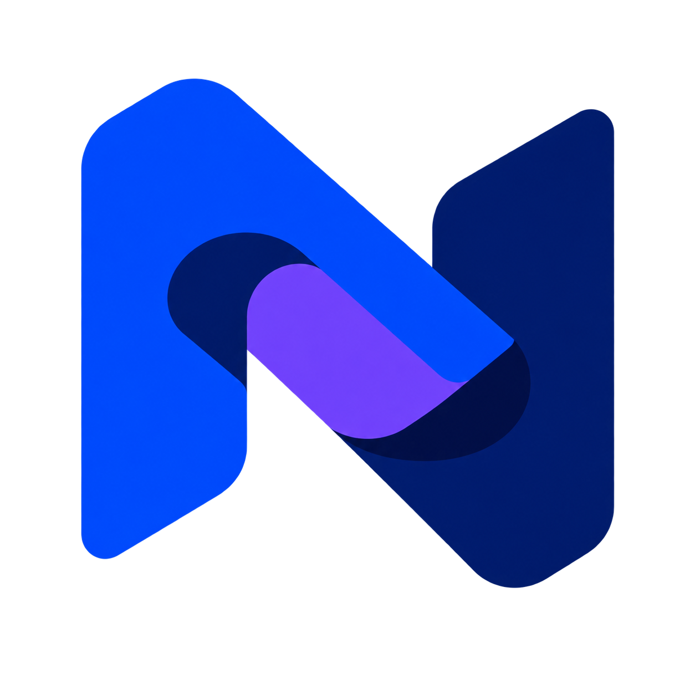

<p align="center">
  
</p>

# Numera Browser

<div align="center">

[](https://github.com/KiaroSama/Numera-Browser/actions/workflows/native-ci.yml)
[](LICENSE)
[](https://github.com/KiaroSama/Numera-Browser/tags)
[](https://github.com/KiaroSama/Numera-Browser/releases)
[](#development-and-verification)
[](rust-toolchain.toml)
[](#install)
[](#install)
[](docs/setup.md)
[](#development-and-verification)
[](docs/architecture.md)
[](dashboard/README.md)
[](#ai-agent--mcp-integration)
[](#donate)

</div>

Numera Browser is a local browser profile manager. It keeps sessions, cookies,
proxy settings and browser identity settings separate per profile. The core,
CLI, HTTP API and MCP server use Rust 1.100.0. Tauri hosts the Rust/WASM dashboard,
which uses the Glimm transition when switching between light and dark themes.
For reduced motion, the dashboard switches themes without the sweep.

## Install

Download only assets listed under [Releases & Tags](#releases-and-tags). Pick the
asset that matches the operating system and CPU. Verify it before running or
extracting it. A CI artifact is not a signed release.

| Target | Desktop packages | Headless server |
| --- | --- | --- |
| Windows x64 (`windows-x64`) | MSI or portable ZIP | CLI-only ZIP |
| Windows arm64 (`windows-arm64`) | MSI or portable ZIP | CLI-only ZIP |
| Linux x64 (`linux-x64`) | AppImage, DEB or portable ZIP | CLI-only tar.gz |
| Linux arm64 (`linux-arm64`) | AppImage, DEB or portable ZIP | CLI-only tar.gz |

Windows desktop builds need WebView2. Linux desktop builds need WebKitGTK 4.1
and GTK 3. For portable installs, extract the whole `Numera Browser` directory
and run `numera.exe` on Windows or `numera` on Linux. Keep the adjacent engine
files in place. The Windows publisher certificate is self-signed; do not disable
platform security or install an unknown root to get around a warning.

### Headless Server (CLI-Only) Installation

Download `numera-browser-cli-<version>-<target>.zip` on Windows or
`numera-browser-cli-<version>-<target>.tar.gz` on Linux. Verify and extract the
archive, then add the extracted directory to your `PATH`. Keep `numera-engine` and
`numera-browser-runtime` together. The CLI needs no Tauri shell, WebView or
windowing session. Launching a browser still requires that browser's SDK, binary
and platform libraries; the headless package does not bundle them.

Run `numera-engine --help` or start the loopback HTTP service:

```bash
numera-engine --data-dir ./numera-data serve --host 127.0.0.1 --port 8787
```

Source builds and browser resource setup are in [docs/setup.md](docs/setup.md).

### Source installation

Install Rust **1.100.0**, the WASM target and the pinned binding tool to build
and serve the dashboard with the native engine:

```bash
rustup target add wasm32-unknown-unknown
cargo install wasm-bindgen-cli --version 0.2.129 --locked
cargo run --manifest-path dashboard/Cargo.toml --locked --bin dashboard-build
cargo build --manifest-path engine-rust/Cargo.toml --locked --features native-product,native-browser --bins
cargo run --manifest-path engine-rust/Cargo.toml --locked --features native-product,native-browser --bin numera-engine -- serve --port 8787
```

Open <http://127.0.0.1:8787>. Browser launching additionally needs its matching
vendor resources; [setup](docs/setup.md#from-source) describes explicit acquisition.
For frontend development, keep the engine running and start
`cargo run --manifest-path dashboard/Cargo.toml --locked --bin dashboard-dev`
in a second terminal. The Rust development server proxies `/api` to port 8787.

Detailed platform prerequisites, alternative browser setup, Docker, headless
configuration and troubleshooting are in [docs/setup.md](docs/setup.md).

## AI Agent & MCP Integration

Start `numera-engine mcp` for newline-delimited JSON-RPC over stdio. If your agent
runs beside an existing Numera service, use the HTTP bridge:

```bash
numera-engine mcp --bridge http://127.0.0.1:8787
```

The bridge forwards calls to `POST /api/mcp` on the configured service. Add
`--token <bearer>` when the service requires it. Keep management and CDP ports
private, and leave the bridge on loopback unless you have explicitly configured
remote authenticated access. For direct CLI calls, use `--json` to receive a
machine-readable result and check the process exit code. Some commands expose
profile data or secrets, so keep raw output out of shared logs.

### CLI / MCP / GUI Feature Parity

The GUI calls the same Rust manager as the CLI and MCP. That keeps profile edits,
proxy checks, cookie exports and workflow actions on the same validation and
storage paths. See [the agent command guide](docs/agents.md) and the installed
binary's `--help` for exact commands.

| Feature | What you can do |
| --- | --- |
| Browser automation | Navigate, fill forms, take a snapshot or screenshot, and read console or network results through the Rust Playwright/CDP layer. |
| Profile identity | Set a Dolphin-style MAC address and device name for a profile. This changes browser-visible profile metadata, never the host network interface. |
| Proxy checks | Review the apparent exit IP, country name and flag when a country match is available. |
| Cookie export | Export a profile's cookies in JSON or Netscape format. Treat both files as credentials. |
| Local workflows | Save and run local steps. Use multi-window sync to send the same supported action to selected profile sessions. |

## Browser backends

| Backend | Resources |
| --- | --- |
| `playwright` | Playwright SDK and its matched Chromium. |
| `patchright` | Its own SDK and matched Chromium. |
| `camoufox` | Firefox build, add-ons and data. Camoufox generates parts of its own identity. |
| `cloak` | Native preparation plus a separately licensed vendor browser. Public packages exclude the proprietary binary. |

Full x64 desktop packages include reviewed browser resources; ARM64 desktop packages and CLI-only archives do not. Use the
[setup guide](docs/setup.md) for platform-specific prerequisites. Cloak requires
explicit consent, a license and access to the selected vendor generation.

`BrowserEngineProvider` is the interface for plugging in browser engines and
update behavior. Numera Core Browser is a planned provider. It is not included
in this release workflow.

## Data and updates

Use **Settings → Storage** to find the actual data directory. Back up that
entire directory before upgrading; a profile export is not a backup of browser
sessions. `--data-dir` and `NUMERA_DATA_DIR` take precedence over the default.

The portable updater handles application and browser-core updates. Its settings
control what can update automatically. The updater verifies signed metadata,
defers while owned work is active or uncertain, and leaves the `data/` directory
alone. See [updates and signature verification](docs/updates.md) for supported
feeds, manual approval, recovery and the distinction between a release download
and an updater-compatible generation.

## Releases & Tags

<a id="releases-and-tags"></a>

- [Releases](https://github.com/KiaroSama/Numera-Browser/releases): signed downloads, detached signatures and checksums once a run publishes them.
- [Tags](https://github.com/KiaroSama/Numera-Browser/tags): version references, including tags without published assets.
- [Changelog](CHANGELOG.md): current changes and links to older versions.

Before extracting or running a package, verify `SHA256SUMS.sig` and the matching
asset's `.sig` using a separately trusted copy of the publisher certificate.
[Release verification commands](docs/updates.md#verify-a-versioned-download) show
how to verify the signatures and compare the package hash.

## Logs

The native engine writes UTF-8 logs under the actual data root's `logs/`, one
`numera_YYYY-MM-DD_HH-mm-ss_UTC.log` per run, with a collision suffix when needed.
Entries use `[YYYY-MM-DD HH:mm:ss UTC] [LEVEL] [COMPONENT] Message`. Verbose mode adds
diagnostics; redaction is applied before file output. The engine retains a bounded
set of run logs; see [engine-rust/README.md](engine-rust/README.md) for its controls.

Desktop/update and build tooling keep their own lifecycle diagnostics. The native
runtime records fixed vault-enable phases in `logs/native-vault-enable_*_UTC.log`
(with collision suffixes); these diagnostic-only logs never fall back to console
output or extend command-capture idle deadlines. On creating a log, the native
runtime prunes the oldest matching runs per component toward a 20-file limit,
ordered by modification time. Active or linked files are preserved; pruning
failures can leave extra logs. Missing logs mean unavailable evidence, not completion.
Other logging initialization failures produce a safe console fallback rather than
pretending a log exists. Review logs before sharing them: redaction is a safety measure, not
permission to publish raw cookies, tokens or profile data.

## Development and verification

| Directory | Contains |
| --- | --- |
| [`engine-rust/`](engine-rust/) | Profile storage, CLI, Axum HTTP API, MCP, browser worker |
| [`dashboard/`](dashboard/) | Rust/WASM dashboard and tests |
| [`desktop/`](desktop/) | Tauri shell, engine lifecycle and updater |
| [`tools/xtask/`](tools/xtask/) | CI, resource provisioning, package and signature tools |

[Native CI](.github/workflows/native-ci.yml) builds the desktop and CLI-only
packages on all four 64-bit targets. Its required checks cover the maintained
suite inventory, CLI/MCP/dashboard contracts, real browser behavior, relocation,
process ownership, dependencies and CodeQL (`actions` and `rust`). Live Cloak
needs the vendor license; its offline and contract tests do not. Hosted timing
and memory comparisons are published in the `browser-benchmark` artifact for
diagnosis. A functional, ownership or cleanup failure still fails CI.

## Responsible use

Use Numera only on systems and accounts you are authorized to test, and within
the terms of its [license](LICENSE). Do not use it for fraud, credential abuse,
spam or bypassing access controls.

## Author

[KiaroSama](https://github.com/KiaroSama) · [Kiaro.Sama.Dev@gmail.com](mailto:Kiaro.Sama.Dev@gmail.com)

## License

Copyright (c) 2026 KiaroSama. Numera Browser is licensed under the [Noncommercial Network Share-Alike License 1.0](LICENSE).

## Donate

If this project helps you, donations are appreciated.

| Currency | Network | Address |
| --- | --- | --- |
| Bitcoin (BTC) | Bitcoin | `bc1qmth5m03pu5hujw5xw5jmywam3jj3sqwqupesdt` |
| USDT, BNB, USDC, etc. | BEP20 | `0x0Bd0BA443a8B9cf15922bf7f0Bb0a4b495fD06Ef` |
| USDT, TRX, USDC, etc. | TRC20 | `TWBA3xFTqgZAeAYMxqo85xWnzvty3DcAhw` |
| Ethereum (ETH) | ERC20 | `0x0Bd0BA443a8B9cf15922bf7f0Bb0a4b495fD06Ef` |
| TON | TON | `UQCN8Umo_OfOWqImZetQsrNStPcmLkMAKajFyiCOhso23NDb` |
| Litecoin (LTC) | LTC | `ltc1qntqnnrunadurnw4cshv3qgspywrueyyeyngwuy` |
| Solana (SOL) | Solana | `7B2wkczUjmkDhETwQuknBL8sUsbuV7nErxc317TmQuwR` |
| Polygon (POL) | Polygon | `0x0Bd0BA443a8B9cf15922bf7f0Bb0a4b495fD06Ef` |
